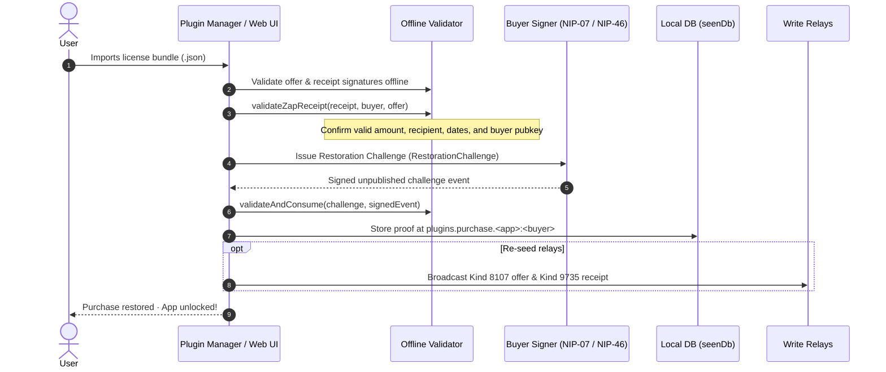

# Plugin Payments: Recovery, Recourse & Reviews Implementation Plan

This implementation plan details the architectural specifications and step-by-step tasks for the settled features:
1. **Offline Export & Import of Purchase Proofs** (with cryptographic challenge-response verification)
2. **Checkout DM Recourse** (direct encrypted NIP-17 messaging for delayed receipts/refunds)
3. **App Comments & Ratings** (NIP-22 Kind 1111 + NIP-32 Kind 1985 with ratings breakdown & WoT filtering)

---

## 1. Offline Export & Import of Purchase Proofs

### Rationale & Design
Relay retention is unpredictable; relays may prune Kind 9735 zap receipts or go offline. A buyer who has already verified ownership on one device must be able to export their cryptographic license and import it onto another instance without relying on relays.

To prevent piracy / receipt sharing, the import flow enforces a **Restoration Challenge**: the importing user must cryptographically prove ownership of the buyer pubkey embedded inside the receipt.

### Data Structure (`.appweaver-license.json`)
```typescript
export type ExportedPurchaseBundle = {
  version: 1;
  app: string;          // Coordinate e.g. "32107:<author-pubkey>:<package-name>"
  buyer: string;        // Buyer pubkey (hex)
  exportedAt: number;   // Unix seconds
  offer: NostrEvent;    // Kind 8107 offer event signed by author
  receipt: NostrEvent;  // Kind 9735 zap receipt signed by provider
};
```

### Flow & Verification Steps


### Tasks
- [ ] Add `exportPurchase(ctx, app, buyer)` returning `ExportedPurchaseBundle`.
- [ ] Add CLI subcommand `/plugins export-purchase <alias>` and a button in the Web terms modal.
- [ ] Add `importPurchase(ctx, bundleJson)`:
  - Validate `verifyEvent(bundle.offer)` and `verifyEvent(bundle.receipt)`.
  - Validate offer-to-receipt match via `validateZapReceipt`.
  - Trigger `issueChallenge` and `validateAndConsume` via `src/commands/plugin-manager/install/restoration.ts`.
  - Save `PurchaseProof` to `plugins.purchase.<app>:<buyer>`.
  - Optional: re-publish offer & receipt to current write relays.
- [ ] Add Drag-and-drop / file picker for license import in the Web installer.

---

## 2. Checkout DM Recourse & Refund Flow

### Rationale & Design
When a buyer pays a Lightning invoice but the Lightning provider fails to publish or deliver the Kind 9735 receipt, the client cannot forge a receipt. Putting the buyer in direct contact with the author via an encrypted NIP-17 DM provides immediate recourse for manual refund or resolution.

### DM Payload (Pre-filled)
```text
AppWeaver Purchase Support Request
App: <title> (<coordinate>)
Purchase Attempt: <attemptId>
Invoice: <bolt11>
Timestamp: <created_at>

Payment was settled in my wallet, but the provider did not deliver a zap receipt. Please verify and assist or issue a refund.
```

### Tasks
- [ ] In `src/commands/plugin-manager/install/renderers/payments.ts` (when check attempts time out or delayed receipt notice is shown):
  - Add a **"Contact Author via DM"** action.
- [ ] When clicked in Web UI:
  - Resolves author pubkey and author NIP-10050 / NIP-17 DM relays.
  - Opens direct message modal / chat session pre-filled with the support request payload.
- [ ] Author refund workflow:
  - Author confirms invoice settlement in wallet / LNURL node.
  - Author sends sats back to buyer's LN address or Nostr pubkey.

---

## 3. App Comments & Ratings (NIP-22 & NIP-32)

### Rationale & Design
App reviews and ratings provide decentralized social proof and community feedback. By leveraging NIP-22 (Kind 1111 comments) and NIP-32 (Kind 1985 labels/ratings), AppWeaver maintains compatibility with existing Nostr app platforms (such as Zapstore).

### Relay Strategy
To ensure discoverability and performance, comments and ratings are queried from:
- `PLUGIN_QUERY_RELAYS` (`relay.ditto.pub`, `relay.primal.net`, `nos.lol`, `nostr.mom`).
- Author's NIP-65 write relays (outbox).
- Buyer's active relays.

### Nostr Event Contracts
#### 1. NIP-22 Comment (Kind `1111`)
```json
{
  "kind": 1111,
  "content": "Great app! Seamless setup.",
  "tags": [
    ["A", "32107:<author-pubkey>:<d-identifier>", "<relay-hint>"],
    ["p", "<author-pubkey>"],
    ["l", "5", "rating/5"]
  ]
}
```

#### 2. Rating & Validation Rules
- **Optional rating**: Rating tag `["l", "<1-5>", "rating/5"]` is optional if `content` is non-empty.
- **Optional text**: `content` can be empty if a valid rating tag `1..5` is present.
- **Validation**: At least one of rating or non-empty comment text must be provided.

### UI Specifications in `/plugins list`
1. **Catalog Card Badge**:
   - `5 💬 · ⭐ 4.9/5 (42 reviews)`
   - Displays count of comments (`💬`), average star score (`⭐`), and total reviews.
2. **Review Modal**:
   - **Header**: Overall score and star display (including half-star SVG support for `4 < R < 5`).
   - **Ratings Breakdown**: Histogram showing distribution of 5★, 4★, 3★, 2★, 1★.
   - **Filters**:
     - Sort by: Most Recent, Highest Rated, Lowest Rated (to surface complaints/issues).
     - **Web of Trust (WoT) filter toggle**: Filter reviews to show only ratings from followed profiles or trusted contacts.
   - **Submit Review**:
     - Star picker (1 to 5 stars).
     - Text area for optional review body.
     - Signs and broadcasts to catalog relays and author inbox relays.

### Tasks
- [ ] **Contract & Queries**:
  - Add `fetchAppReviews(ctx, appCoordinate, relays)` querying Kind 1111 and Kind 1985 with `#A: [appCoordinate]`.
  - Add rating calculation helper: computes average rating, distribution histogram, and review counts.
- [ ] **WoT Filtering**:
  - Integrate user follow list (Kind 3) / contacts to filter reviews by WoT depth (direct follow or 2nd-degree).
- [ ] **Web UI**:
  - Add badge `5 💬 · ⭐ 4.9/5 (42 reviews)` to `plugins-install-title-row`.
  - Create `ReviewModal` with star distribution breakdown, WoT filter toggle, sort dropdown, and review list.
  - Create review submission form with star picker and text input.
- [ ] **Publication**:
  - Implement `publishAppReview({ ctx, appCoordinate, authorPubkey, rating, comment })` broadcasting to `PLUGIN_QUERY_RELAYS` and author write relays.
